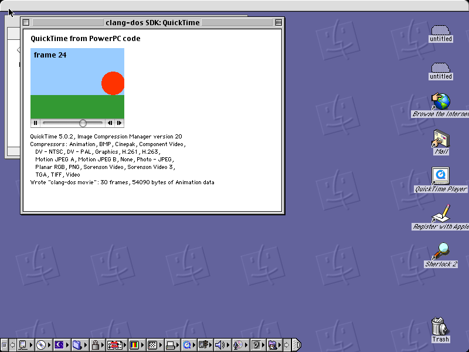

# Mac OS 8, Mac OS 9 and QuickTime

## Mac OS 8

<!-- include README.md "Mac OS 8" -->

## Mac OS 9

<!-- include README.md "Mac OS 9" -->

## QuickTime

<!-- include README.md "QuickTime" -->

<figure markdown>

<figcaption>A QuickTime movie on Mac OS 9 (PowerPC).</figcaption>
</figure>
