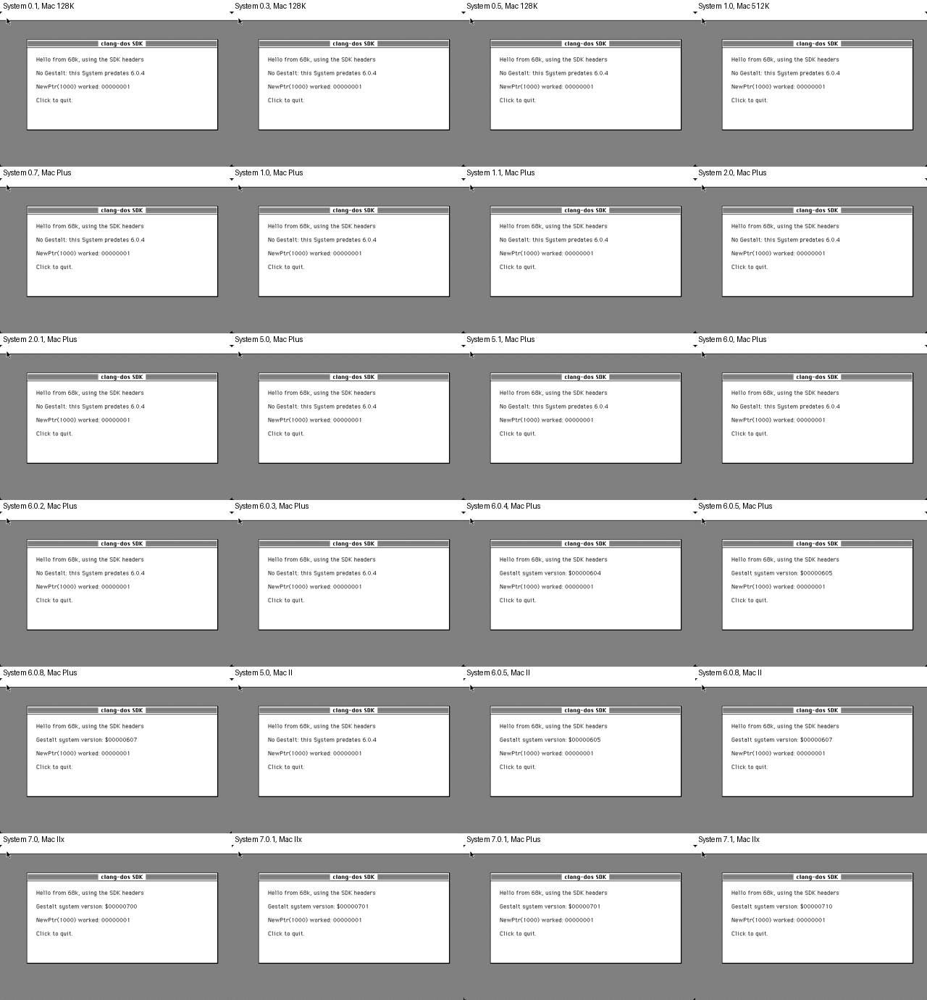

---
hide:
  - navigation
---

# Classic Mac OS SDK

<!-- include README.md "" -->

```sh
clang --target=m68k-apple-macos     -O2 -Iinclude -c hello.c   # 68k
clang --target=powerpc-apple-macos9 -O2 -Iinclude -c hello.c   # PowerPC
```

<div class="grid cards" markdown>

-   :material-file-code: **The Toolbox headers**

    ---

    [Universal Interfaces style headers](headers.md) for 68k and PowerPC, from System 0.1 to Mac OS 9.

-   :material-history: **Which System has which call**

    ---

    [Every call and the oldest System that has it](systems.md), measured on 29 System and machine pairs.

-   :material-new-box: **Mac OS 8, 9 and QuickTime**

    ---

    The [Appearance Manager, Navigation Services, QuickTime](headers-newer.md) and more.

-   :material-chart-box: **Coverage**

    ---

    [What is declared and what is not yet](coverage.md).

</div>

<figure markdown>
{ width="720" }
<figcaption>examples/hello.c, built as a fat application, on every System from 0.1 to Mac OS 9.</figcaption>
</figure>
